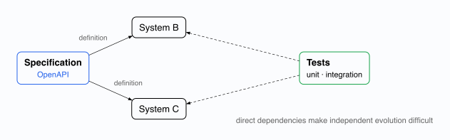
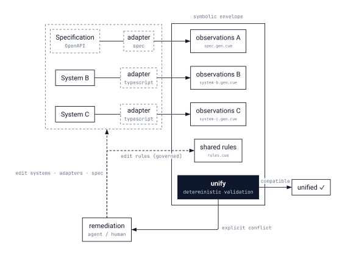
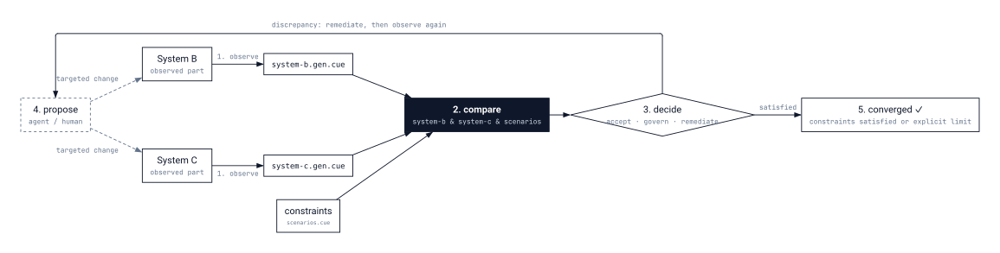

# Enamel

**Translucent harness for structural integrity**

Enamel observes a chosen part of a real system, projects it into [CUE](https://cuelang.org/), and lets people and agents validate their changes against that model. The model is deliberately partial: enough verified structure to steer and validate change, without pretending to describe every implementation detail.

> Enamel provides the means; each project defines the semantics.

## In thirty seconds

An adapter observes a TypeScript module through the language server and writes what it sees as CUE:

```cue
// extract.gen.cue — generated, never edited by hand
observation: functions: findUser: {
	parameters: {id: "string"}
	return: Promise: "User"
	async: true
}
```

A person writes the intent, in the same package:

```cue
// spec.cue — human-owned
intent: functions: findUser: {
	parameters: close({id: "string"})
	return: Promise: "User"
	async: true
}
```

Shared rules unify the two: `conforms: intent & observation & {...}`. If someone later makes `findUser` synchronous, the observation changes and `cue vet` reports an explicit conflict instead of a silent drift:

```text
conforms.functions.findUser.async: conflicting values true and false
```

That conflict is the signal an agent or a person acts on. Nothing in this loop asks a model to judge correctness; CUE decides, deterministically.

## Vocabulary

Five words carry the whole approach. The diagrams and the docs use them consistently.

- **System**: the real thing, a service, a codebase, a schema. Enamel never models all of it.
- **Adapter**: the component that observes a chosen part of a system and emits CUE. Each adapter states what it observes and what it omits.
- **Observation**: the CUE produced by an adapter for one system. Deterministic: same input, same output.
- **Constraint**: CUE authored by people, such as a contract, an architectural rule, or a scenario.
- **Envelope**: the unification of observations and constraints. It bounds the set of acceptable systems. Adding a constraint narrows it; it never widens it.

Enamel is the **harness** around the envelope: the adapters, the validation, and the convergence loop described next.

## How it works

### 1. Direct dependencies make evolution brittle



In a direct model, a specification such as OpenAPI drives downstream systems. Tests capture part of the relationship, but there is no independent representation in which to evaluate the whole composition. Changing one system therefore tends to tightly constrain the others.

### 2. A symbolic envelope provides a shared boundary



Enamel introduces a **symbolic envelope**: adapters transform a part of each system into observations, then shared rules unify those observations with the constraints. Downstream systems may evolve independently when their observations continue to satisfy the envelope. Agents work against that same boundary rather than relying on either the specification or the implementation alone.

### 3. Change converges through a bounded loop



1. **Observe** the system through an adapter.
2. **Compare** that observation with the intended constraints.
3. **Decide** whether the discrepancy is acceptable, requires a governed constraint change, or needs remediation.
4. **Propose and validate** a targeted change.
5. **Observe again** until the constraints are satisfied or the process reaches its explicit limit.

Adapters may use source analysis, schemas, compiler APIs, language servers, runtime introspection, or traces. There is no universal extraction mechanism. For unchanged input, an adapter should produce the same canonical observation.

## Try it

[`examples/typescript-lsp-cue`](examples/typescript-lsp-cue) is the example behind the snippet above. It queries `typescript-language-server` over LSP, generates the observation, and unifies it with the human-owned intent and an architectural policy:

```sh
cd examples/typescript-lsp-cue
mise install
npm install
mise run check
```

Then make a presentation handler import the repository directly and run `mise run check` again: the layered dependency policy in `architecture.cue` rejects the observation.

[`examples/subscription-service`](examples/subscription-service) is a larger, runnable TypeScript, PostgreSQL, Docker and NATS service. Its envelope makes service contracts, invariants, dependencies and evidence inspectable alongside the implementation.

## Design choices

### Why CUE

CUE combines data, schemas, and constraints in one declarative representation, which suits describing both what an adapter observes and the rules that observation must satisfy. Enamel relies on CUE unification: compatible information combines, incompatible requirements produce an explicit conflict. That gives people and agents a deterministic validation boundary.

A similar pipeline without CUE is possible but costs more:

- **Merging representations from different sources:** CUE is monotonic, which makes it well suited to accumulating compatible information and surfacing conflicts as the envelope is composed.
- **Verifying rules:** without CUE, the rules must be substantially simpler, or an equivalent constraint and unification system must be implemented in another language.

Using CUE does not make an observation complete or prove that a system is correct. The guarantees still depend on the adapter contract and on the constraints being expressed.

### Why translucency

Agents need dependable context, but complete representations of real systems are costly to construct, quickly become stale, and still miss important behavior. Partial context alone is not sufficient either: without clear meaning and limits, it can create false confidence.

A translucent interface states what it observes, what those observations mean, which constraints they can support, and what remains unknown. This makes uncertainty inspectable and helps reconcile the three views that commonly drift apart: the intended specification, the observable state of the system, and the changes proposed by agents.

### Principles

- **Adapters have explicit contracts.** An adapter's contract defines what it represents faithfully, what it omits, and which guarantees its output can support.
- **Validation is deterministic.** Generation may be probabilistic; validation must not be. Expectations are composable constraints a proposal can be checked against.
- **Convergence is iterative.** Enamel identifies a discrepancy, proposes a focused remediation, then re-observes and re-validates.
- **Constraint changes are governed.** Adding a constraint narrows the accepted set; removing or relaxing one expands it. Those are distinct operations, and an agent must not silently weaken the contract to eliminate a failure.

## What Enamel can and cannot establish

Enamel keeps three questions separate:

1. **Extraction fidelity:** Does an adapter observe the properties it claims to observe?
2. **Validation composability:** Do the declared constraints combine predictably?
3. **Generation feasibility:** Can a proposed change bring the system into conformance without violating existing invariants?

Answers depend on the system and its adapter. A structurally valid observation is not proof of behavioral correctness, safe execution, or successful convergence.

Enamel is not a complete model of every system, a claim that an LLM can determine correctness unaided, a replacement for domain-specific tests and review, or a universal extractor based on one protocol or language service. Where a complete formal model is required, Enamel can be paired with an interactive theorem prover and verified extraction; see [Rocq integration](docs/rocq.md).

## Going deeper

- [Enamel: synthesis](docs/synthesis.md): the conceptual synthesis and its relationship to knowledge bases.
- [Adjunctions](docs/adjunctions.md): the model behind the envelope, with extraction, free generation, and concretization.
- [Rocq integration](docs/rocq.md): combining CUE validation with proof-checked behavioral properties.
- [Coinductive Repair](https://github.com/stratorys/coinductive-repair): the remediation pattern Enamel supports, validate, repair, validate again. In Enamel this loop is bounded by the envelope: a repair is accepted because the observations satisfy shared constraints, not because it removes a local error.

### Intellectual context

Enamel began with the joking ambition to “do that again in Clojure and Specter, for once,” drawing on the idea of a Data Engineering Exoskeleton. It has since evolved into a simplified expression of the core mechanics of design convergence.

Enamel seems to be aligned with Peter Naur’s *Programming as Theory Building*: meaningful understanding must remain available as a system evolves. It proposes a technical complement rather than a replacement for human understanding: a translucent harness that exposes relevant structure without prescribing implementation.

Patrick and Radhia Cousot’s work on *Abstract Interpretation* provides another useful framing: complex program behavior can be analyzed through a deliberately simplified semantic representation. Enamel similarly works with a partial representation, but makes the limits of that representation part of its contract.

Frederick P. Brooks Jr.’s *No Silver Bullet* is an important caution. Abstractions and tools cannot eliminate the essential complexity of software; a symbolic envelope must not claim to capture the entire system.

## Diagrams

The diagram sources live in [`assets/`](assets/). Rebuild them with:

```sh
mise install
mise run build-assets
```

## Status

Enamel is a design-stage project. This repository will develop the shared model, adapter contracts, constraint representation, and convergence workflow described here.

## License

Copyright 2026 Jonathan Winandy. Enamel is licensed under the [Apache License 2.0](LICENSE).

## Acknowledgements

Thanks to [Valentin Bergeron](https://github.com/vbergeron) and [Cyril DESCHAMPS](https://github.com/CyrilDesch) for exploring the approach and its tooling, generous technical discussions, and valuable feedback; Valentin also named the project.

We are grateful to Marcel van Lohuizen and the CUE team, including Paul Jolly and Jonathan Matthews. CUE's design and availability have been foundational to this exploration of symbolic space.

## References

- [CUE language](https://cuelang.org/)
- Peter Naur, [*Programming as Theory Building*](https://doi.org/10.1093/comjnl/28.3.253), *The Computer Journal*, 1985
- Patrick Cousot and Radhia Cousot, [*Abstract Interpretation: A Unified Lattice Model for Static Analysis of Programs by Construction or Approximation of Fixpoints*](https://doi.org/10.1145/512950.512973), POPL, 1977
- Frederick P. Brooks Jr., [*No Silver Bullet—Essence and Accident in Software Engineering*](https://doi.org/10.1109/MC.1987.1663532), *IEEE Computer*, 1987
- [Coinductive Repair](https://github.com/stratorys/coinductive-repair), by Lucas Jahier
