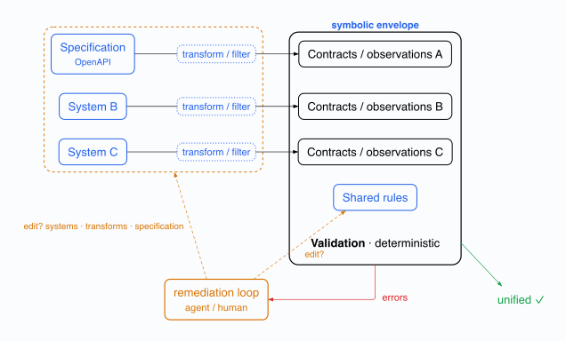

# Enamel

**Reconciling specs, code, and agents.**

Enamel is a translucent interface between real systems and agentic generation. It makes systems legible enough for agents to safely propose changes without requiring a complete model of their implementation.

Rather than treating a codebase, infrastructure stack, or running service as either fully opaque or exhaustively modeled, Enamel exposes a **translucent** view: the selected properties that matter for steering, validating, and converging changes, while irrelevant detail remains opaque.

## Why translucency?

Agentic generation needs reliable context, but complete representations of real systems are expensive to build, quickly become stale, and still fail to capture everything that matters.

Partial information alone is not enough. A translucent interface deliberately states:

- what it observes;
- what those observations mean;
- which constraints they support; and
- what it cannot claim.

This makes uncertainty explicit rather than hiding it behind a supposedly complete model. Enamel reconciles three views that otherwise drift apart: the intended specification, the observable code and system state, and the changes proposed by agents.

## Workflow

### 1. Direct dependency workflow


In the direct model, System A is the OpenAPI definition that drives Systems B and C. Tests describe some of that relationship, but there is no independent space in which to evaluate the composition. This makes independent evolution difficult.

### 2. Symbolic envelope



Enamel adds a symbolic envelope. Each system is transformed into contracts and observations, which are unified with shared rules. Systems B and C can evolve independently as long as their observed representations continue to satisfy the envelope derived from System A. Agents propose changes against that same envelope instead of treating the specification or implementation as the sole source of truth.

### 3. Convergence loop


Adapters can draw on source analysis, schemas, compiler APIs, LSP, runtime introspection, or traces. For a system that has not changed, its adapter should produce the same canonical observation. No single extraction mechanism is assumed to be universal.

The diagram source is [`assets/workflow.typ`](assets/workflow.typ). Render it with:

```sh
mise install
mise run build-assets
```

## Core ideas

### Adapters have explicit contracts

An adapter extracts an observable specification from a system. Its contract defines the scope of that observation: what is faithfully represented, what is omitted, and the guarantees the resulting specification can support.

### Constraints are deterministic

Generated changes may be probabilistic; validation must not be. Enamel represents expectations as composable constraints so proposed changes can be checked against an explicit contract.

### Convergence is iterative

Enamel compares an observed specification with an intended one, identifies the discrepancy, proposes a targeted change, then observes and validates again. It does not assume a single generation step can correctly transform a complex system.

### Constraint changes are governed

Adding a constraint narrows the configurations that are accepted. Removing or relaxing one expands them. Enamel treats those as different operations: no agent should silently weaken a validation contract merely to make a failure disappear.

## Guarantees, kept separate

Enamel distinguishes three questions that are often conflated:

1. **Extraction fidelity:** does an adapter observe the properties it says it observes?
2. **Validation composability:** do the declared constraints combine predictably?
3. **Generation feasibility:** can a proposed modification actually make the system conform without violating its existing invariants?

The answer depends on the adapter and system. A valid structural representation does not, by itself, prove behavioural correctness, safe execution, or successful convergence.

## Non-goals

Enamel is not:

- a claim to completely model every system;
- an assertion that an LLM can decide correctness on its own;
- a replacement for domain-specific tests, review, or operational controls; or
- a universal extractor built from one protocol or language service.

## Programming as Theory Building

Enamel is conceptually aligned with Peter Naur's *Programming as Theory Building*: semantic understanding should be available to guide the evolution of a system.

Naur describes the central role of human understanding in programming. Enamel proposes a technical complement: a translucent semantic harness that exposes the relevant structure of a system without necessarily prescribing its implementation. It gives agents and people a shared, inspectable space in which to evaluate proposed changes.

This alignment is not evidence that Enamel solves the problem Naur identifies. Its value depends on whether an adapter and its harness preserve enough meaning to support coherent generation and subsequent modification.

## Future of programming

Enamel also sits within a broader question: if agents can generate or modify substantial parts of a system, how do people retain agency, understanding, and justified trust in the result?

Its answer is not to require agents to reconstruct the entire system. Instead, it makes the intent, observed structure, and validation boundary explicit and inspectable. This creates a place where people and agents can negotiate a change using shared constraints, then test whether the resulting composition is coherent.

This connects Enamel to the themes of Harvard's [Future of Programming](https://future.metareflection.club/syllabus.html) seminar: expressing intent to computers, human-AI collaboration, and maintaining trust in systems shaped by AI. Enamel is one possible technical exploration of those questions, not a general solution to them.

## Example: coinductive repair

[Coinductive Repair](https://github.com/stratorys/coinductive-repair) is a useful example of the remediation pattern that Enamel supports: validate a candidate system, identify a discrepancy, apply a targeted repair, then validate again until the composition reaches a stable state.

In Enamel, this loop is bounded by the symbolic envelope. A repair is accepted because the resulting observations satisfy the shared constraints, not merely because it removes a local error.

## References

- [CUE language](https://cuelang.org/)
- [Meta-Reflection Club](https://future.metareflection.club/)
  - [Syllabus](https://future.metareflection.club/syllabus.html)
  - [Schedule](https://future.metareflection.club/schedule.html)
  - Peter Naur, [*Programming as Theory Building*](https://doi.org/10.1093/comjnl/28.3.253), *The Computer Journal*, 1985
- [Coinductive Repair](https://github.com/stratorys/coinductive-repair)

## Status

Enamel is currently a design-stage project. This repository will evolve into the shared model, adapter contracts, constraint representation, and convergence workflow described above.

## Guiding principle

> Expose enough of a system to steer change with evidence without pretending to know the whole system.
