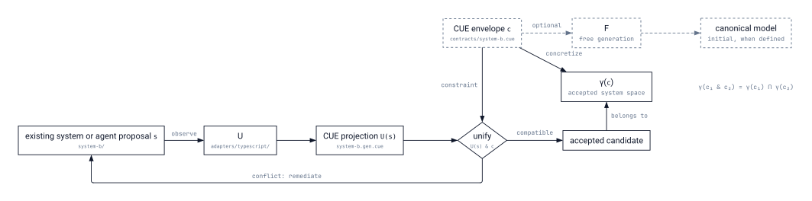

# Adjunctions

Enamel does not attempt to establish an exhaustive semantic contract between languages or systems. Such a contract is usually impractical to create and difficult to keep current. Instead, it observes a deliberately limited slice of a system: a projection of the structure relevant to a particular constraint.

Each projection adds a facet to an envelope of conformance. In CUE, compatible constraints unify, restricting the space of systems that remain acceptable. The resulting validation is associative, commutative, and idempotent: constraints may be added in any order, and applying the same constraint twice does not change the result.

## The triple structure

The model is organized around a deterministic extraction function $U$:

$$
F \dashv U \dashv \gamma
$$

where:

- $U$ is a forgetful extraction: it projects a concrete system into its CUE observation, omitting implementation detail that is irrelevant to the envelope.
- $F$ is free generation: given a specification, it constructs its initial or least model when the specification belongs to a fragment where that model is defined.
- $\gamma$ is concretization: it maps a constraint to the concrete systems whose observation satisfies it.

## In a real system

The labels in the diagram are illustrative: `system-b/` is an existing or proposed service, `adapters/typescript/` extracts its observed structure, `system-b.gen.cue` is the resulting projection, and `contracts/system-b.cue` contributes constraints to the envelope.

The schema distinguishes two paths that are often conflated:

- $F$ starts from a specification and can construct a canonical model only in fragments where such a model exists.
- $U$ starts from a real, existing, or proposed system and deterministically extracts only the part Enamel observes.
- $\gamma(c)$ describes the accepted space: every concrete system whose $U$ projection is compatible with the CUE envelope $c$.

In normal use, Enamel primarily relies on $U$ and $\gamma$. An agent may propose a candidate by any means; CUE determines whether its observed projection belongs to the accepted space. $F$ explains the cases where generation can be canonical rather than exploratory.

The essential validation law is:

$$
\gamma(c_1 \mathbin{\&} c_2) = \gamma(c_1) \cap \gamma(c_2).
$$

Here, $\mathbin{\&}$ denotes CUE unification. Combining constraints narrows the accepted set of systems; it never broadens it. This is why independently owned checks can accumulate into a shared envelope without requiring coordination between their authors.

## Generation and validation have different roles

Free generation is deterministic only for suitable logical fragments, such as equational theories or Horn clauses. In those fragments, $F$ can construct a canonical initial model from a specification.

In the general case, a concrete system may already exist independently of any specification. A specification then restricts or describes that system; it does not uniquely generate it. Even when generation produces a candidate model, relating that model to a particular target system can require substantial additional adaptation.

Disjunction changes the situation. When a CUE specification admits alternatives, there may be several minimal models rather than one canonical model. Choosing among those alternatives is a search problem. An LLM can act as a stochastic sampler that proposes candidates, but it is not part of the trusted validation path.

Validation remains deterministic. A candidate either unifies with the envelope or produces an explicit conflict. The generator may be partial and probabilistic; $\gamma$ still composes through intersection.

## Consequences for Enamel

The system can converge through successive, independent projections:

1. An adapter extracts a deterministic CUE observation using $U$.
2. A constraint is unified with the existing envelope.
3. A person or agent proposes a system that may satisfy the narrowed space.
4. Enamel observes it again and checks the result.

This does not make the system semantically complete. It makes the chosen boundary explicit and composable. Every successful check restricts the possible systems to those compatible with one more observable facet, while unobserved implementation details remain outside the contract.

## Scope

This is a design model for Enamel, not yet a formal proof about its implementation. A full treatment would define the concrete system domain, the CUE constraint lattice, $U$, $F$, and $\gamma$, then establish the stated adjunctions for the fragments in use.
